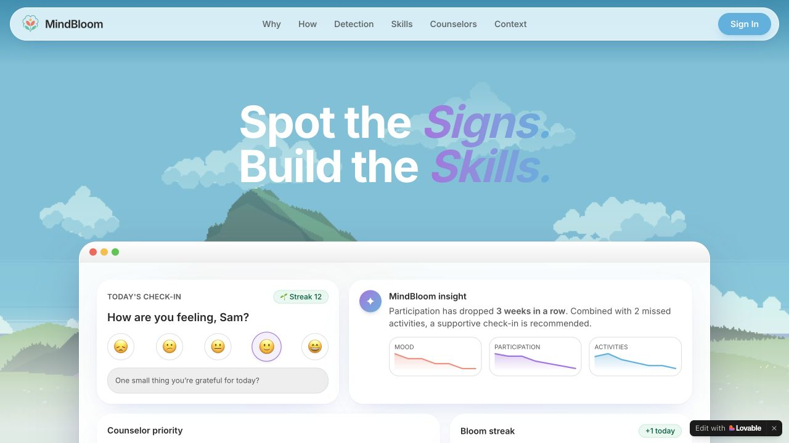
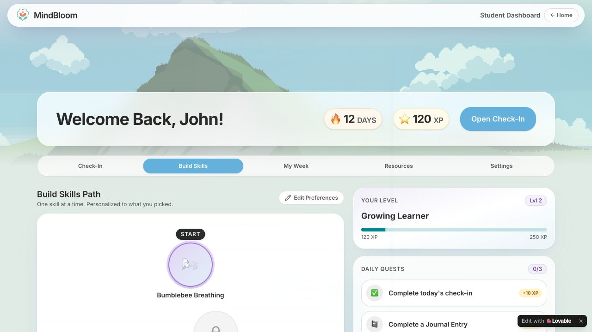
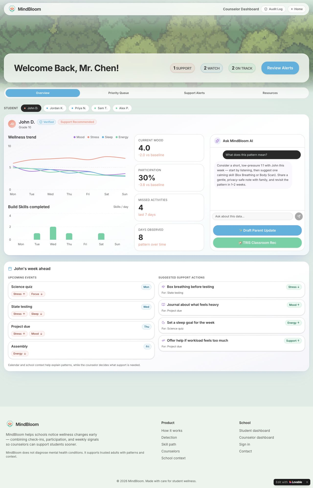

<div align="center">


# MindBloom

**Spot the Signs. Build the Skills.**

A student wellness prototype that connects daily check-ins, small wellness habits, and explainable patterns with supportive counselor workflows.

**[Live demo](https://mindbloom-ai-app.lovable.app/)** · **[Student dashboard](https://mindbloom-ai-app.lovable.app/student-dashboard)** · **[Counselor dashboard](https://mindbloom-ai-app.lovable.app/counselor-dashboard)**

🏅 **4th place · 2026 UA Little Rock AI Hackathon & HealthTech Startup Week**

[Development guide](docs/DEVELOPMENT.md) · [Project story & team](docs/PROJECT_NOTES.md) · [Team presentation](https://docs.google.com/presentation/d/1iDPEgJtQppI4zQXNg8ko-38plpY3MKdfvMvlYerw0jU/edit)

</div>



## Small signals, thoughtful support

MindBloom explores a simple loop: **check in → practice a skill → notice patterns → offer support**. Students get an encouraging space to reflect and build habits. Counselors get a clearer view of changes over time, with explanations that keep people involved in deciding what support is appropriate.

## Explore the prototype

| Experience | What it includes |
| --- | --- |
| 🌤️ Daily check-ins | Mood, stress, energy, and sleep ratings, with optional journal reflections. |
| 🌬️ Build Skills | Breathing, mindfulness, grounding, journaling, stress reset, and emotional regulation activities. |
| 🌱 Resilience Garden | A garden, XP, streaks, daily quests, and progress feedback. |
| 📈 Explainable insights | Explicit rules compare sample signals with a student's own baseline and describe the changes. |
| 🤝 Counselor workspace | Trend charts, a priority queue, support alerts, and demonstration outreach tools. |
| 📅 Context | Demonstrations of calendar, wearable, and school context alongside wellness patterns. |

<details>
<summary><strong>See the student and counselor workspaces</strong></summary>

### Student skill path



### Counselor overview



All student names and wellness signals shown here are demonstration data.

</details>

## Try it in two minutes

1. Open the [student dashboard](https://mindbloom-ai-app.lovable.app/student-dashboard). Explore the check-in form, or choose **Do later** to browse.
2. Open **Build Skills**. Choose a theme, difficulty, and activity preference, then select **Build My Path**.
3. Visit the [counselor dashboard](https://mindbloom-ai-app.lovable.app/counselor-dashboard). Acknowledge the sample alert to explore trends and student profiles.
4. Try **What does this pattern mean?** to see the demonstration explanation workflow.

Use sample data while exploring. The role-selection screen is a demo; dashboard links are directly accessible.

## Run locally

Install Bun, then clone the repository and use the committed lockfile:

```sh
git clone https://github.com/anaypandit/mindbloom.git
cd mindbloom
bun install --frozen-lockfile
cp .env.example .env
```

Fill in your own Supabase project configuration in `.env`, then start the app:

```sh
bun run dev
```

Open the local URL printed by Vite. See the [development guide](docs/DEVELOPMENT.md) for environment variables, build commands, the source map, and hosting notes.

## Built with

**React 19 · TypeScript · TanStack Start/Router · Vite · Tailwind CSS 4**

Radix/shadcn components provide UI primitives; Recharts draws trends; Lottie animates the garden; Lucide supplies icons. Supabase integration scaffolding is included. The team built and iterated on the current app in **Lovable**.

## Prototype scope

The dashboards use sample data, component state, and browser-local storage. The analysis in [src/lib/mindbloom-ai.ts](src/lib/mindbloom-ai.ts) uses explicit rules; it is not a trained diagnostic model or a live LLM service. Calendar, wearable, sign-in, and outreach flows include demonstration behavior. Interface labels about privacy or encryption do not establish production authentication, access controls, or end-to-end encryption.

MindBloom supports exploration of student wellness workflows. It does not diagnose conditions, and clinical effectiveness has not been established. [Project notes](docs/PROJECT_NOTES.md) explain the current boundaries in more detail.

## Team and recognition

Built by **Anay Pandit, Hannah Robertson, Jake Hu, Joel Johnson, Luke Wang, Rudra Pratap Mukherjee, Tanisha Virani, and Vishak Meenachi** during the June 8–12, 2026 hackathon at UA Little Rock.

The team earned **4th place and a $2,000 team prize**. [UA Little Rock's coverage](https://ualr.edu/news/2026/06/16/arkansas-students-reimagine-healthcare-at-ua-little-rock-ai-hackathon/) features Mind Bloom and its team. See [project notes](docs/PROJECT_NOTES.md) for award provenance, AI-assisted development, and the source export history.
